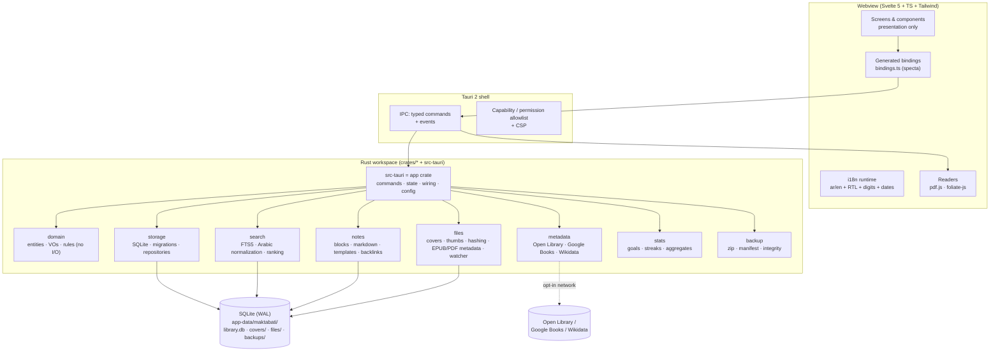
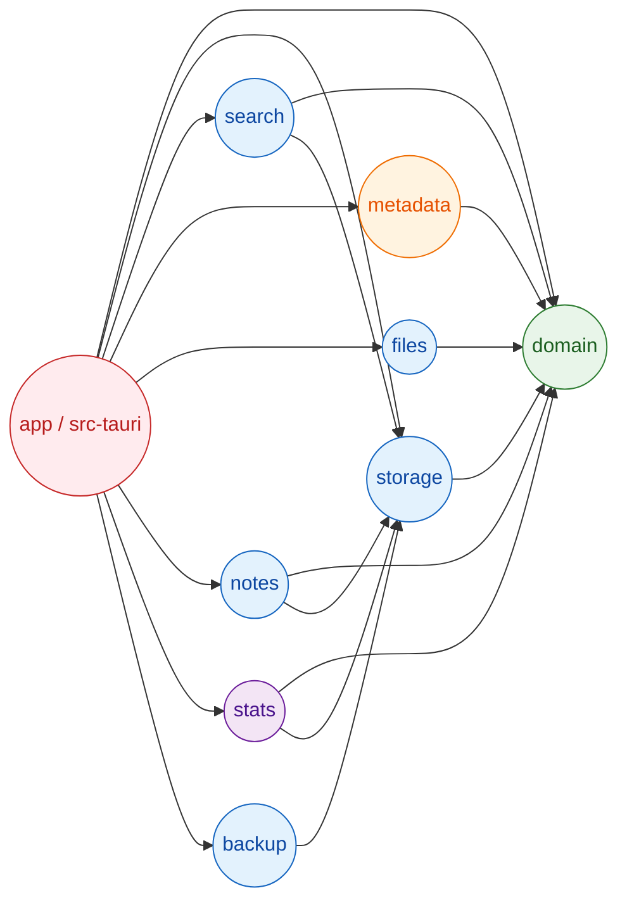
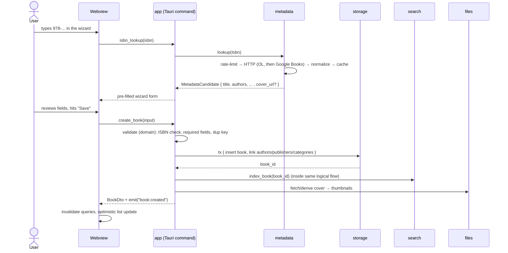
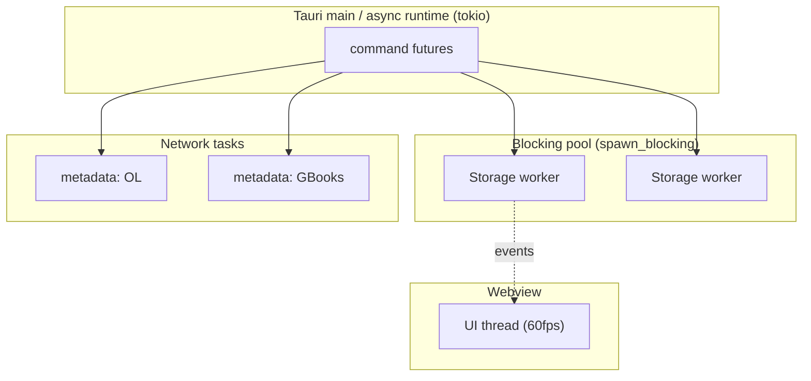
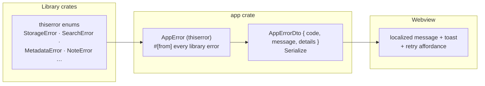
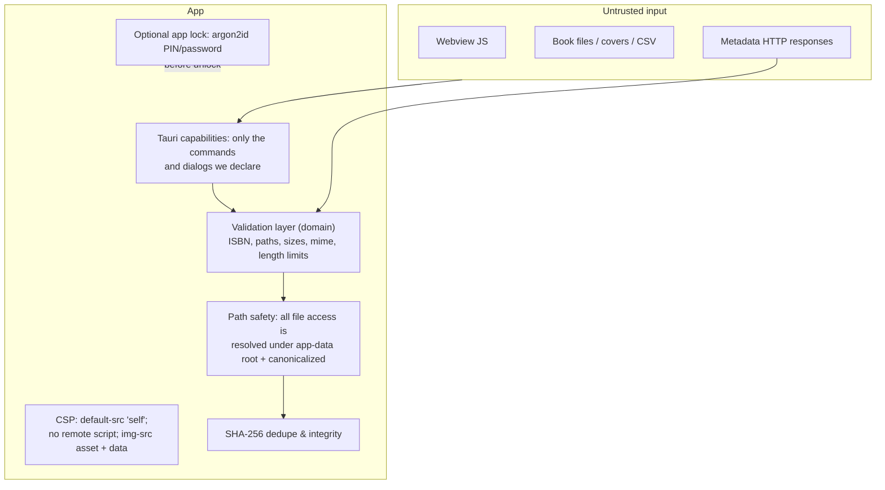
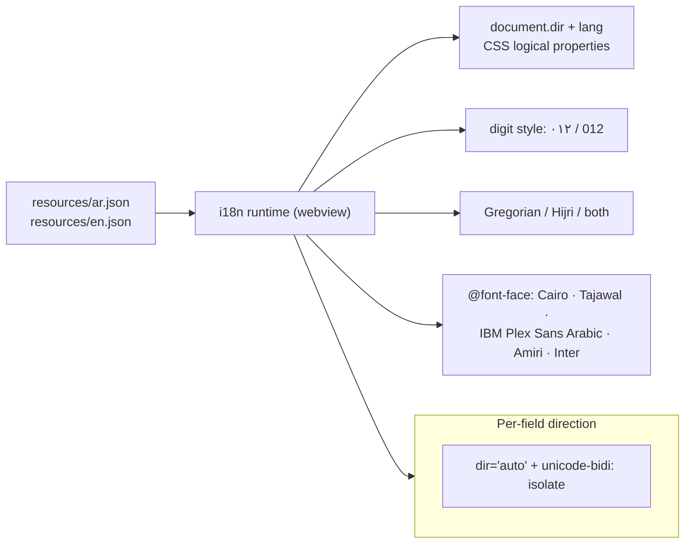

# 02 — Architecture

**Project:** Maktabati / مكتبتي
**Last updated:** 2026-10-18
**Status:** Baseline for Milestone 2 (scaffold)

Companion ADRs live in [`docs/adr/`](adr/). Every deviation from the brief's suggested stack is
recorded there.

---

## 1. Guiding principles

1. **Local-first & offline by default.** The app is fully functional with the network cable
   pulled. Network is used only for metadata lookups the user triggers or explicitly enables.
2. **Rust owns the truth.** All business logic, persistence, validation, search, file handling,
   metadata fetching, backups and aggregation live in Rust. The webview is a *presentation
   layer* that calls typed commands and renders.
3. **Pure core, impure shell.** `domain` has no I/O and no Tauri/SQLite/HTTP types. Everything
   that touches the world is at the edge.
4. **One source of truth.** SQLite holds data *and* the FTS index — same transaction, no drift.
5. **The type contract is generated, never hand-written** (ADR-0002).
6. **Bilingual is a structural concern**, not a string table: direction, digits and dates are part
   of the data model and the design tokens.

---

## 2. Layered view



**Rule of thumb:** arrows only ever point *downward* and *inward*; nothing below `app` may
depend on Tauri, the webview, or any UI type.

---

## 3. Crate dependency graph



**Invariants (enforced by `cargo deny` bans + review):**

- `domain` depends on: `serde`, `thiserror`, `chrono`, `uuid`, `unicode-normalization`,
  `unicode-segmentation`, `isbn`. **No** `tokio`, `sqlx`/`rusqlite`, `reqwest`, `tauri`.
- `search`, `storage`, `notes`, `backup` may depend on `domain` + `storage`, never on `app`.
- Only `app` depends on `tauri*`.
- No crate outside `metadata` may create an HTTP client (`cargo deny` bans `reqwest` elsewhere
  via `[bans]` wildcards, plus a CI grep).

### 3.1 Responsibility of each crate

| Crate | Owns | Must not do |
|---|---|---|
| `domain` | Entities, value objects (ISBN, Language, Rating, Progress…), business rules (e.g. rating aggregation, status transitions, duplicate keys), domain errors, Arabic normalization *rules* | Any I/O; no DB/HTTP/Tauri types |
| `storage` | SQLite connections, PRAGMAs, migrations, repositories, transactions, seed data, row↔entity mapping | Business rules; network |
| `search` | FTS5 schema + triggers, query parsing (Calibre-style), Arabic normalize-at-write, ranking, snippet generation | Own its own copy of data |
| `metadata` | Provider trait, Open Library / Google Books / Wikidata clients, rate limiter, response cache, offline fallback, field merging policy | Writing to DB (returns DTOs) |
| `files` | Cover extraction/generation, thumbnail cache, SHA-256 hashing, EPUB/PDF embedded metadata read, folder scanning, `notify` watcher | Rendering (webview renders) |
| `notes` | Block model, block↔Markdown codec, templates, backlink index, autosave/revision handling | Editor rendering |
| `stats` | Reading sessions → charts, goals, streaks, heatmap series, rubric aggregates per author/publisher | UI formatting |
| `backup` | Zip archive create/restore, SHA-256 manifest, verification, pre-migration hook | Deciding *what* to back up |
| `app` = **`src-tauri/`** (package name `maktabati-app`) | Tauri commands, state (`OnceLock`/`tauri::State`), config, tracing setup, i18n runtime bridge, specta export, tray/menu/window setup | Business logic (delegates) |

> **Naming note:** the brief lists `crates/app (or src-tauri)`. We use **`src-tauri` as the app
> crate itself** (package `maktabati-app`) so `cargo tauri` and `cargo build --workspace` agree
> on one location; every other crate lives under `crates/`.

---

## 4. Data flow — adding a book by ISBN



**Failure path:** if the network is down, `metadata` returns `Err(Offline)` and the wizard simply
stays manual — no error dialog, no retry loop, no blocking.

---

## 5. IPC / command boundary

### 5.1 Shape

Commands are **thin**: parse args → call one service → return a serializable DTO. They are
grouped in modules mirroring the crates:

```
books::list(query) -> Page<BookListItem>
books::get(id) -> BookDetail
books::create(input) -> BookDetail
books::update(id, input) -> BookDetail
books::delete(id) -> ()
authors::…  publishers::…  categories::…  tags::…
reading::set_status :: start_cycle :: log_session :: progress
notes::list_blocks :: apply_patch :: create_page :: backlinks :: export_markdown
quotes::…  reviews::…  rubric::…
files::attach :: remove :: scan_folder :: thumbnail
metadata::isbn_lookup :: search_title :: fetch_cover
shelves::…  search::query  palette::search
dashboard::summary :: heatmap :: series
backup::create :: restore :: verify   settings::get :: set
```

### 5.2 Contract rules

- Every command is annotated `#[tauri::command] #[specta::specta]`.
- All argument/return types derive `Serialize + Deserialize + specta::Type`.
- Bindings are exported to `src/bindings.ts` in a **test** and in `main` under
  `debug_assertions`; CI runs `cargo test -p app export_bindings` and fails if the file changed
  (drift detection). → ADR-0002
- Errors cross IPC as a **structured `AppErrorDto { code, message, details? }`**; the webview
  maps `code` → localized message. Never leak raw Rust `Display` strings to the UI.
- Long operations emit **events** (`import:progress`, `scan:progress`, `backup:progress`) so the
  UI can render determinate progress instead of a spinner.
- Commands that read large lists return **paged** results (`Page<T> { items, total, offset, limit }`);
  the webview virtualizes.

### 5.3 Concurrency model



- **SQLite access is synchronous** (`rusqlite`) and always executed on `spawn_blocking`
  (ADR-0005). A single `Pool` of N connections (N = 2..4) with WAL allows 1 writer + readers.
- All writes that span multiple statements run inside `connection.transaction()`.
- Network work (`reqwest`, rustls) runs as async tasks with a per-source token-bucket limiter.
- UI thread never blocks: every command is `async` from the webview's perspective; results
  arrive via the IPC reply or an event.
- No `unsafe`, no `Mutex` held across `.await`; state is `Arc<...>` behind short-lived locks.

---

## 6. Error-handling strategy



Rules:

1. Libraries define **typed** `thiserror` errors with a stable `code()` method (e.g.
   `not_found`, `validation.isbn_invalid`, `storage.busy`, `metadata.rate_limited`, `offline`).
2. `app` converts everything into one `AppError`; `impl Serialize` produces `AppErrorDto`.
3. **No `unwrap()`/`expect()` on user input or I/O results** in non-test code (enforced by clippy
   lints `unwrap_used`, `expect_used` allowed only in `tests/` and `*_test_utils`).
4. Programmer errors (`unreachable!`) may panic; everything else returns.
5. Every error surfaced to the user must be **actionable** and localized (`error.*` keys).
6. `tracing` records the full chain at `error`/`warn`; the log viewer reads the rolling file.

---

## 7. Offline-first behavior

| Concern | Behavior offline |
|---|---|
| Startup | Never touches the network. Cold start target < 2 s. |
| Metadata lookup | Opt-in; returns `Offline` → wizard stays manual; queued only if user pressed "Retry" |
| Covers | Local cache first; remote fetch only on explicit action or explicit setting |
| App update | Checked only when the user enables it; failure is silent (logged) |
| Backups / restore / search / notes / reading | Always available |
| Diagnostics | Network status is a first-class settings indicator |

There is **no** background sync, no telemetry, no analytics.

---

## 8. Security model



- **Capability allowlist:** only `core:default`, plus the specific dialog/opener/fs scope needed,
  plus our own commands. `http` plugin is **not** enabled for the webview — HTTP only in Rust.
- **CSP** denies remote scripts/styles; only bundled fonts/assets are loaded.
- **Path safety:** the webview can never pass an arbitrary path. It passes an *id* or a
  user-selected path validated by the Rust side; every open re-canonicalizes and checks the
  prefix of the resolved path against the allowed roots.
- **File validation:** extension allowlist + magic-byte sniff + size cap before copying.
- **App lock:** argon2id hash of the PIN/password, stored locally; unlock gates command execution.
- **No network except** `metadata` crate (allow-listed hosts) — enforced by banning `reqwest`
  outside that crate.

---

## 9. i18n, RTL and text handling



- **All strings externalized**; a CI test fails on missing/extra keys between `ar` and `en`.
- Layout uses **CSS logical properties** (`margin-inline-start`, `padding-inline`, `inset-inline`)
  so RTL mirroring is automatic rather than hand-mirrored.
- Per-field: every place a user-authored string is rendered uses `dir="auto"` and
  `unicode-bidi: isolate` so "العنوان العربي" and "English Author" coexist on one card.
- Arabic normalization for search happens in **Rust** (`domain`), so it applies identically to
  storage, search and duplicate detection.

---

## 10. Persistence & offline data layout

```
{app-data}/maktabati/            # directories crate → OS-correct location
├── library.db                   # SQLite (WAL), FTS5 content tables
├── library.db-wal / -shm
├── covers/                      # originals + {hash}_{w}.webp thumbnails
├── files/                       # copied attachments (by content hash)
├── backups/                     # maktabati-YYYYMMDD-HHMMSS.zip
├── logs/maktabati.log           # tracing, size-rotated
└── settings.json                # non-secret prefs (theme, language, digits…)
```

**Migrations:** numbered SQL files embedded with `include_str!`, applied in a transaction,
recorded in `_migrations`. Before applying any migration the app takes an automatic backup
(ADR-0003).

---

## 11. Packaging & distribution

| Target | Artifact | Notes |
|---|---|---|
| Windows (primary) | **MSI** and **NSIS** via `tauri bundler` | WebView2 evergreen bootstrapper; tray; file associations for `.epub/.pdf` optional |
| Linux | **AppImage** + **.deb** | Needs `webkit2gtk` on the build host; AppImage avoids dependency hell |
| macOS | **dmg** (x86_64 + aarch64) | Notarization is a release-time step |
| Updates | `tauri-plugin-updater` + signed `.sig` | Ships **disabled** until signing keys exist (spec Q3) |

CI (GitHub Actions) builds and tests on **Windows and Linux** on every push; macOS build is
tag-only.

---

## 12. Architecture Decision Records

| ADR | Title | Status |
|---|---|---|
| [0001](adr/0001-ui-framework.md) | UI framework: Tauri 2 + Svelte 5 + Tailwind + Bits UI (webview over Leptos) | Accepted |
| [0002](adr/0002-type-contract.md) | Generate the TS↔Rust contract with specta / tauri-specta | Accepted |
| [0003](adr/0003-persistence.md) | SQLite file layout, WAL, migrations + automatic pre-migration backup | Accepted |
| [0004](adr/0004-search.md) | SQLite FTS5 over tantivy; Arabic normalization at write time | Accepted |
| [0005](adr/0005-db-access-layer.md) | `rusqlite` instead of sqlx / SeaORM (deviation from brief) | Accepted |
| [0006](adr/0006-notes-storage.md) | Notes as structured blocks in SQLite + Markdown projection | Accepted |
| [0007](adr/0007-readers.md) | pdf.js + foliate-js in the webview; Rust handles files, not rendering | Accepted |
| [0008](adr/0008-metadata-providers.md) | Open Library + Google Books only; rate limiting, caching, adapter seam | Accepted |
| [0009](adr/0009-frontend-stack.md) | Svelte 5 + TS + Tailwind + Vite; fonts bundled locally | Accepted |
| [0010](adr/0010-error-and-concurrency.md) | Single `AppError` DTO boundary; sync SQLite on `spawn_blocking` | Accepted |
| [0011](adr/0011-barcode-scanning.md) | Barcode scanning is COULD; typed/paste ISBN is the guaranteed path | Accepted |
| [0012](adr/0012-type-contract-escape-hatch.md) | Contingency if specta/tauri-specta cannot ship | Accepted (contingency) |

---

## 13. Cross-cutting concerns checklist

- [x] Offline-first (§7)
- [x] Security (§8)
- [x] i18n/RTL (§9)
- [x] Error handling (§6)
- [x] Concurrency (§5.3)
- [x] Performance targets → `01-product-spec.md` §5.1, realized by virtualization + FTS5 + paged IPC
- [x] Observability → `tracing` rolling file + in-app log viewer + diagnostic export
- [x] Testability → pure `domain` (unit), `storage` (temp-file integration), `metadata`
      (wiremock), `search` (proptest + insta), commands (integration), UI (Playwright/tauri-driver
      for critical flows)
