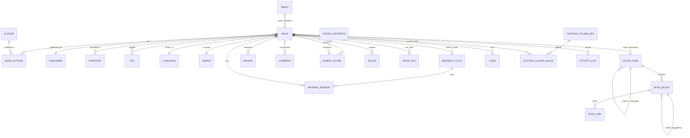

# 03 — Data Model

**Project:** Maktabati / مكتبتي · **Last updated:** 2026-10-18
**Storage:** SQLite (WAL), file `{app-data}/maktabati/library.db` — see ADR-0003
**Access layer:** `rusqlite` — see ADR-0005 · **Search:** FTS5 — see ADR-0004

---

## 1. Conventions

| Topic | Rule |
|---|---|
| Primary keys | `TEXT` **UUID v7** (time-sortable, index-friendly, no INTEGER churn). Generated in `domain`. |
| Instants (`*_at`) | `INTEGER` **epoch milliseconds UTC**. Never local time in storage. |
| Date-only (`*_date`, `due_date`, `session_date`) | `TEXT` **`YYYY-MM-DD`** — deliberately timezone-free (a reading day is a calendar day). |
| Years (`publication_year`, `birth_year`) | `INTEGER` nullable |
| Booleans | `INTEGER 0/1` with `CHECK (x IN (0,1))` |
| Ratings (overall + rubric) | `INTEGER 0..10` = **half-stars** (0.5 step). Display divides by 2. Avoids float drift. |
| Progress | `INTEGER 0..100` with `CHECK` |
| Money | amount `INTEGER` **minor units** + `currency TEXT` (ISO-4217) — never REAL |
| JSON payloads | `TEXT` + `CHECK (json_valid(x))` |
| Enums | `TEXT` + `CHECK (x IN (...))` — readable in `sqlite3`, safe on write |
| User text | Stored **raw** (original script). Normalized copies live in `*_norm` columns used only for search/dedupe. |
| Numerals | **Stored Western/ASCII always** (`٠١٢` never enters the DB) so sorting, ranges and search are stable. Arabic-Indic digits are a *display* setting applied by the frontend formatter (see `04-ux-design.md` §7.10). |
| Soft delete | **None.** Deletes are real; safety comes from backups (ADR-0003). |
| Timestamps | `created_at`, `updated_at` maintained by repository code (no triggers writing them) except where noted. |

### 1.1 Arabic normalization contract

`*_norm` columns are produced by `domain::text::normalize()` (ADR-0004):

```
NFD → strip combining marks (removes tashkeel/tanwin) → strip tatweel U+0640
→ fold {أ,إ,آ,ٱ}→ا , ى→ي , ة→ه , ؤ→و , ئ→ي → strip control/format chars
→ collapse whitespace → trim → lowercase Latin
```

Optional **light stemming** is applied at *index* time only when enabled in settings (default
off), and the raw normalized string is always kept so turning stemming off can rebuild the index
without data loss.

---

## 2. ER diagram



---

## 3. Full schema

The canonical DDL is `crates/storage/migrations/0001_init.sql`, embedded at compile time. It is
reproduced here verbatim in annotated sections.

### 3.1 Core catalogue

```sql
CREATE TABLE languages (
  code        TEXT PRIMARY KEY,           -- BCP-47-ish: 'ar', 'en', 'fr'…
  name_ar     TEXT NOT NULL,
  name_en     TEXT NOT NULL,
  direction   TEXT NOT NULL CHECK (direction IN ('rtl','ltr')),
  is_active   INTEGER NOT NULL DEFAULT 1 CHECK (is_active IN (0,1)),
  position    INTEGER NOT NULL DEFAULT 0
);

CREATE TABLE publishers (
  id          TEXT PRIMARY KEY,
  name        TEXT NOT NULL,
  name_norm   TEXT NOT NULL,
  country     TEXT,
  city        TEXT,
  website     TEXT,
  notes       TEXT,
  cover_path  TEXT,
  created_at  INTEGER NOT NULL,
  updated_at  INTEGER NOT NULL
);
CREATE UNIQUE INDEX ux_publishers_name_norm ON publishers(name_norm);

CREATE TABLE authors (
  id            TEXT PRIMARY KEY,
  name          TEXT NOT NULL,            -- display name (Arabic or Latin as written)
  name_norm     TEXT NOT NULL,
  name_original TEXT,                     -- name in the author's own script
  name_original_norm TEXT,
  bio           TEXT,
  nationality   TEXT,
  birth_year    INTEGER,
  death_year    INTEGER,
  photo_path    TEXT,
  created_at    INTEGER NOT NULL,
  updated_at    INTEGER NOT NULL
);
CREATE UNIQUE INDEX ux_authors_name_norm ON authors(name_norm);
CREATE INDEX ix_authors_birth ON authors(birth_year);

CREATE TABLE series (
  id          TEXT PRIMARY KEY,
  name        TEXT NOT NULL,
  name_norm   TEXT NOT NULL,
  description TEXT,
  created_at  INTEGER NOT NULL,
  updated_at  INTEGER NOT NULL
);
CREATE UNIQUE INDEX ux_series_name_norm ON series(name_norm);

CREATE TABLE categories (                 -- hierarchical tree
  id          TEXT PRIMARY KEY,
  parent_id   TEXT REFERENCES categories(id) ON DELETE CASCADE,
  key         TEXT NOT NULL,              -- stable machine key, never localized
  name_ar     TEXT NOT NULL,
  name_en     TEXT NOT NULL,
  name_norm   TEXT NOT NULL,
  path        TEXT NOT NULL,              -- materialized path: '/literature/novels/fantasy'
  depth       INTEGER NOT NULL DEFAULT 0,
  position    INTEGER NOT NULL DEFAULT 0,
  icon        TEXT,
  color       TEXT,
  is_system   INTEGER NOT NULL DEFAULT 0 CHECK (is_system IN (0,1)), -- seeded taxonomy
  created_at  INTEGER NOT NULL,
  updated_at  INTEGER NOT NULL
);
CREATE UNIQUE INDEX ux_categories_parent_key ON categories(parent_id, key);
CREATE UNIQUE INDEX ux_categories_path ON categories(path);
CREATE INDEX ix_categories_parent ON categories(parent_id, position);

CREATE TABLE tags (
  id          TEXT PRIMARY KEY,
  name        TEXT NOT NULL,
  name_norm   TEXT NOT NULL,
  color       TEXT,
  created_at  INTEGER NOT NULL
);
CREATE UNIQUE INDEX ux_tags_name_norm ON tags(name_norm);

CREATE TABLE books (
  id             TEXT PRIMARY KEY,
  title          TEXT NOT NULL,
  subtitle       TEXT,
  original_title TEXT,                    -- native-script title if translated
  title_norm     TEXT NOT NULL,           -- for search + duplicate detection
  language_code  TEXT NOT NULL REFERENCES languages(code),
  isbn10         TEXT,                    -- validated by domain::Isbn
  isbn13         TEXT,
  edition        TEXT,
  publication_year INTEGER,
  page_count     INTEGER CHECK (page_count IS NULL OR page_count > 0),
  format         TEXT NOT NULL DEFAULT 'print'
                   CHECK (format IN ('print','ebook','audiobook','pdf','other')),
  description    TEXT,
  series_id      TEXT REFERENCES series(id) ON DELETE SET NULL,
  series_order   REAL,                    -- supports 1.5 ("1.5" novella)
  -- physical location (collector persona)
  room           TEXT,
  shelf          TEXT,
  box            TEXT,
  -- acquisition
  acquired_date  TEXT,                    -- YYYY-MM-DD
  acquired_from  TEXT,
  price_minor    INTEGER,
  price_currency TEXT,
  condition      TEXT CHECK (condition IS NULL OR condition IN
                   ('new','like_new','very_good','good','fair','poor')),
  -- cover
  cover_path     TEXT,                    -- relative to covers/
  cover_thumb    TEXT,
  cover_source   TEXT CHECK (cover_source IS NULL OR cover_source IN
                   ('manual','openlibrary','googlebooks','embedded','generated')),
  -- current reading state (denormalized for fast filters; see §4.3)
  reading_status TEXT NOT NULL DEFAULT 'to_read'
                   CHECK (reading_status IN ('to_read','reading','finished','paused','abandoned')),
  rating         INTEGER CHECK (rating IS NULL OR (rating BETWEEN 0 AND 10)),
  current_page   INTEGER,
  progress_pct   INTEGER NOT NULL DEFAULT 0 CHECK (progress_pct BETWEEN 0 AND 100),
  -- provenance
  source         TEXT CHECK (source IS NULL OR source IN
                   ('manual','isbn','folder_scan','csv','goodreads','calibre','json')),
  external_ids   TEXT CHECK (external_ids IS NULL OR json_valid(external_ids)),
  created_at     INTEGER NOT NULL,
  updated_at     INTEGER NOT NULL
);
CREATE UNIQUE INDEX ux_books_isbn13 ON books(isbn13) WHERE isbn13 IS NOT NULL;
CREATE UNIQUE INDEX ux_books_isbn10 ON books(isbn10) WHERE isbn10 IS NOT NULL;
CREATE INDEX ix_books_title_norm  ON books(title_norm);
CREATE INDEX ix_books_status      ON books(reading_status);
CREATE INDEX ix_books_year        ON books(publication_year);
CREATE INDEX ix_books_rating      ON books(rating);
CREATE INDEX ix_books_progress    ON books(progress_pct);
CREATE INDEX ix_books_updated     ON books(updated_at DESC);
CREATE INDEX ix_books_created     ON books(created_at DESC);
CREATE INDEX ix_books_series      ON books(series_id, series_order);
CREATE INDEX ix_books_loc         ON books(room, shelf, box);

CREATE TABLE book_authors (
  book_id    TEXT NOT NULL REFERENCES books(id) ON DELETE CASCADE,
  author_id  TEXT NOT NULL REFERENCES authors(id) ON DELETE CASCADE,
  role       TEXT NOT NULL DEFAULT 'author'
               CHECK (role IN ('author','translator','editor','illustrator','foreword','other')),
  position   INTEGER NOT NULL DEFAULT 0,
  PRIMARY KEY (book_id, author_id, role)
) WITHOUT ROWID;
CREATE INDEX ix_book_authors_author ON book_authors(author_id, role);

CREATE TABLE book_categories (
  book_id     TEXT NOT NULL REFERENCES books(id) ON DELETE CASCADE,
  category_id TEXT NOT NULL REFERENCES categories(id) ON DELETE CASCADE,
  position    INTEGER NOT NULL DEFAULT 0,
  PRIMARY KEY (book_id, category_id)
) WITHOUT ROWID;
CREATE INDEX ix_book_categories_cat ON book_categories(category_id);

CREATE TABLE book_tags (
  book_id TEXT NOT NULL REFERENCES books(id) ON DELETE CASCADE,
  tag_id  TEXT NOT NULL REFERENCES tags(id) ON DELETE CASCADE,
  PRIMARY KEY (book_id, tag_id)
) WITHOUT ROWID;
CREATE INDEX ix_book_tags_tag ON book_tags(tag_id);

-- Translators have NO separate table: they are `book_authors` rows with
-- role = 'translator' (the brief's Book.translators field). A dedicated table
-- would create two competing sources of truth for the same fact.
```

### 3.2 Reading

```sql
CREATE TABLE reading_cycles (             -- one row per read / re-read
  id           TEXT PRIMARY KEY,
  book_id      TEXT NOT NULL REFERENCES books(id) ON DELETE CASCADE,
  started_at   INTEGER,
  finished_at  INTEGER,
  start_page   INTEGER,
  end_page     INTEGER,
  source       TEXT NOT NULL DEFAULT 'manual'
                 CHECK (source IN ('manual','reader','import')),
  note         TEXT,
  created_at   INTEGER NOT NULL
);
CREATE INDEX ix_cycles_book ON reading_cycles(book_id, started_at DESC);
CREATE INDEX ix_cycles_open ON reading_cycles(book_id) WHERE finished_at IS NULL;

CREATE TABLE reading_sessions (           -- activity log entries
  id            TEXT PRIMARY KEY,
  book_id       TEXT NOT NULL REFERENCES books(id) ON DELETE CASCADE,
  cycle_id      TEXT REFERENCES reading_cycles(id) ON DELETE SET NULL,
  session_date  TEXT NOT NULL,            -- YYYY-MM-DD (user's calendar day)
  started_at    INTEGER,
  ended_at      INTEGER,
  pages_read    INTEGER CHECK (pages_read IS NULL OR pages_read >= 0),
  minutes       INTEGER CHECK (minutes   IS NULL OR minutes   >= 0),
  note          TEXT,
  created_at    INTEGER NOT NULL
);
CREATE INDEX ix_sessions_date    ON reading_sessions(session_date);
CREATE INDEX ix_sessions_book    ON reading_sessions(book_id, session_date);
CREATE INDEX ix_sessions_created ON reading_sessions(created_at DESC);

CREATE TABLE loans (                      -- lending tracker
  id           TEXT PRIMARY KEY,
  book_id      TEXT NOT NULL REFERENCES books(id) ON DELETE CASCADE,
  borrower     TEXT NOT NULL,
  phone        TEXT,
  borrowed_at  TEXT NOT NULL,             -- YYYY-MM-DD
  due_date     TEXT,
  returned_at  TEXT,
  reminder_at  TEXT,
  notes        TEXT,
  created_at   INTEGER NOT NULL,
  updated_at   INTEGER NOT NULL
);
CREATE INDEX ix_loans_open ON loans(book_id) WHERE returned_at IS NULL;
CREATE INDEX ix_loans_due  ON loans(due_date) WHERE returned_at IS NULL;

CREATE TABLE reading_goals (
  id            TEXT PRIMARY KEY,
  scope         TEXT NOT NULL CHECK (scope IN ('year','month')),
  year          INTEGER NOT NULL,
  month         INTEGER CHECK (month IS NULL OR (month BETWEEN 1 AND 12)),
  target_books  INTEGER,
  target_pages  INTEGER,
  created_at    INTEGER NOT NULL,
  updated_at    INTEGER NOT NULL
);
CREATE UNIQUE INDEX ux_goals ON reading_goals(scope, year, month);

CREATE TABLE activity_log (
  id          TEXT PRIMARY KEY,
  occurred_at INTEGER NOT NULL,
  kind        TEXT NOT NULL,              -- 'book.created' | 'status.changed' | 'loan.due' …
  book_id     TEXT REFERENCES books(id) ON DELETE CASCADE,
  payload     TEXT CHECK (payload IS NULL OR json_valid(payload))
);
CREATE INDEX ix_activity_time ON activity_log(occurred_at DESC);
CREATE INDEX ix_activity_book ON activity_log(book_id, occurred_at DESC);
```

### 3.3 Evaluation: reviews, comments, rubric

```sql
CREATE TABLE reviews (
  id          TEXT PRIMARY KEY,
  book_id     TEXT NOT NULL REFERENCES books(id) ON DELETE CASCADE,
  rating      INTEGER CHECK (rating IS NULL OR (rating BETWEEN 0 AND 10)),
  body        TEXT,
  created_at  INTEGER NOT NULL,
  updated_at  INTEGER NOT NULL
);
CREATE INDEX ix_reviews_book ON reviews(book_id, created_at DESC);

CREATE TABLE review_comments (            -- multiple dated comments per review
  id          TEXT PRIMARY KEY,
  review_id   TEXT NOT NULL REFERENCES reviews(id) ON DELETE CASCADE,
  body        TEXT NOT NULL,
  commented_at INTEGER NOT NULL,
  created_at  INTEGER NOT NULL
);
CREATE INDEX ix_review_comments ON review_comments(review_id, commented_at);

CREATE TABLE rating_criteria (            -- معايير التقييم (user-defined rubric)
  id           TEXT PRIMARY KEY,
  key          TEXT NOT NULL,             -- stable machine key
  name_ar      TEXT NOT NULL,
  name_en      TEXT NOT NULL,
  description_ar TEXT,
  description_en TEXT,
  weight       REAL NOT NULL DEFAULT 1.0 CHECK (weight >= 0),
  position     INTEGER NOT NULL DEFAULT 0,
  is_active    INTEGER NOT NULL DEFAULT 1 CHECK (is_active IN (0,1)),
  is_system    INTEGER NOT NULL DEFAULT 0 CHECK (is_system IN (0,1)),
  created_at   INTEGER NOT NULL,
  updated_at   INTEGER NOT NULL
);
CREATE UNIQUE INDEX ux_criteria_key ON rating_criteria(key);

CREATE TABLE rubric_scores (
  book_id      TEXT NOT NULL REFERENCES books(id) ON DELETE CASCADE,
  criterion_id TEXT NOT NULL REFERENCES rating_criteria(id) ON DELETE CASCADE,
  score        INTEGER NOT NULL CHECK (score BETWEEN 0 AND 10),
  note         TEXT,
  updated_at   INTEGER NOT NULL,
  PRIMARY KEY (book_id, criterion_id)
) WITHOUT ROWID;
CREATE INDEX ix_rubric_criterion ON rubric_scores(criterion_id, score);
```

**Aggregation rule (domain rule, executed in SQL):** a criterion's average over an author/publisher
counts only books that have a score for it; the *composite* score is the **weighted mean** of
available criteria (weights from `rating_criteria.weight`), and requires ≥ `min_books`
(configurable, default 3) before it is displayed — otherwise the UI shows "not enough data". This
prevents "best publisher = 1 book with a perfect score".

### 3.4 Notes (ADR-0006)

```sql
CREATE TABLE notes_page (
  id            TEXT PRIMARY KEY,
  book_id       TEXT REFERENCES books(id) ON DELETE CASCADE,   -- NULL = standalone page
  parent_page_id TEXT REFERENCES notes_page(id) ON DELETE CASCADE, -- nested sub-pages
  title         TEXT NOT NULL DEFAULT '',
  title_norm    TEXT NOT NULL DEFAULT '',
  icon          TEXT,
  is_template   INTEGER NOT NULL DEFAULT 0 CHECK (is_template IN (0,1)),
  template_key  TEXT,                          -- 'default_book_notes' | user templates
  is_pinned     INTEGER NOT NULL DEFAULT 0 CHECK (is_pinned IN (0,1)),
  position      INTEGER NOT NULL DEFAULT 0,
  rev           INTEGER NOT NULL DEFAULT 0,
  created_at    INTEGER NOT NULL,
  updated_at    INTEGER NOT NULL
);
CREATE INDEX ix_pages_book   ON notes_page(book_id, position);
CREATE INDEX ix_pages_parent ON notes_page(parent_page_id, position);
CREATE INDEX ix_pages_tpl    ON notes_page(is_template) WHERE is_template = 1;
CREATE INDEX ix_pages_title  ON notes_page(title_norm);

CREATE TABLE note_block (
  id               TEXT PRIMARY KEY,
  page_id          TEXT NOT NULL REFERENCES notes_page(id) ON DELETE CASCADE,
  parent_block_id  TEXT REFERENCES note_block(id) ON DELETE CASCADE,
  position         TEXT NOT NULL,             -- fractional index ('a0','a1','a1V'…)
  type             TEXT NOT NULL CHECK (type IN (
      'paragraph','heading_1','heading_2','heading_3',
      'bulleted_list','numbered_list','todo','quote','code',
      'callout','toggle','table','divider','image','page_link','bookmark')),
  payload          TEXT NOT NULL CHECK (json_valid(payload)),
  rev              INTEGER NOT NULL DEFAULT 0,
  created_at       INTEGER NOT NULL,
  updated_at       INTEGER NOT NULL
);
CREATE UNIQUE INDEX ux_blocks_pos ON note_block(page_id, position);
CREATE INDEX ix_blocks_parent ON note_block(parent_block_id, position);
CREATE INDEX ix_blocks_page   ON note_block(page_id, position);

CREATE TABLE note_link (                   -- backlinks, block-granular (Logseq-style)
  id            TEXT PRIMARY KEY,
  from_block_id TEXT NOT NULL REFERENCES note_block(id) ON DELETE CASCADE,
  target_kind   TEXT NOT NULL CHECK (target_kind IN ('page','book','quote')),
  target_id     TEXT NOT NULL,
  raw_text      TEXT NOT NULL,              -- the [[as typed]]
  created_at    INTEGER NOT NULL
);
CREATE UNIQUE INDEX ux_links ON note_link(from_block_id, target_kind, target_id);
CREATE INDEX ix_links_target ON note_link(target_kind, target_id);
```

### 3.5 Quotes, files, covers

```sql
CREATE TABLE quotes (
  id            TEXT PRIMARY KEY,
  book_id       TEXT NOT NULL REFERENCES books(id) ON DELETE CASCADE,
  file_id       TEXT REFERENCES book_files(id) ON DELETE SET NULL,
  text          TEXT NOT NULL,
  text_norm     TEXT NOT NULL,
  note          TEXT,
  page          INTEGER,
  chapter       TEXT,
  color         TEXT NOT NULL DEFAULT 'yellow'
                  CHECK (color IN ('yellow','green','blue','pink','red','purple')),
  position_ref  TEXT,                        -- format-specific reader anchor (ADR-0007)
  source        TEXT NOT NULL DEFAULT 'manual'
                  CHECK (source IN ('manual','reader','import')),
  created_at    INTEGER NOT NULL,
  updated_at    INTEGER NOT NULL
);
CREATE INDEX ix_quotes_book   ON quotes(book_id, created_at DESC);
CREATE INDEX ix_quotes_page   ON quotes(book_id, page);
CREATE INDEX ix_quotes_norm   ON quotes(text_norm);

CREATE TABLE book_files (                  -- attachments
  id            TEXT PRIMARY KEY,
  book_id       TEXT NOT NULL REFERENCES books(id) ON DELETE CASCADE,
  kind          TEXT NOT NULL CHECK (kind IN ('epub','pdf','mobi','azw3','txt','audio','other')),
  original_name TEXT NOT NULL,
  storage_mode  TEXT NOT NULL CHECK (storage_mode IN ('copy','reference')),
  rel_path      TEXT,                       -- copy: relative to files/ (content-addressed)
  abs_path      TEXT,                       -- reference: absolute path as chosen by user
  sha256        TEXT NOT NULL,
  size_bytes    INTEGER NOT NULL,
  mime          TEXT,
  page_count    INTEGER,
  reader_position TEXT,                     -- last position_ref (ADR-0007)
  added_at      INTEGER NOT NULL,
  updated_at    INTEGER NOT NULL
);
CREATE INDEX ix_files_book ON book_files(book_id);
-- Same physical file attached twice is stored once (copy mode) …
CREATE UNIQUE INDEX ux_files_sha_copy ON book_files(sha256) WHERE storage_mode = 'copy';
```

**Dedupe rule:** `sha256` is computed on ingest. In `copy` mode a unique partial index guarantees
one stored blob; the row still points at it, so two books can share one file. In `reference` mode
the file stays where the user put it and is only hashed for identity/integrity.

### 3.6 Shelves, custom columns, settings, cache

```sql
CREATE TABLE shelves (
  id          TEXT PRIMARY KEY,
  name_ar     TEXT NOT NULL,
  name_en     TEXT NOT NULL,
  kind        TEXT NOT NULL DEFAULT 'static' CHECK (kind IN ('static','smart')),
  query_json  TEXT,                          -- smart: serialized filter (see §6)
  icon        TEXT,
  color       TEXT,
  is_favorite INTEGER NOT NULL DEFAULT 0 CHECK (is_favorite IN (0,1)),
  position    INTEGER NOT NULL DEFAULT 0,
  created_at  INTEGER NOT NULL,
  updated_at  INTEGER NOT NULL
);
CREATE INDEX ix_shelves_pos ON shelves(position);

CREATE TABLE shelf_books (
  shelf_id TEXT NOT NULL REFERENCES shelves(id) ON DELETE CASCADE,
  book_id  TEXT NOT NULL REFERENCES books(id)  ON DELETE CASCADE,
  position INTEGER NOT NULL DEFAULT 0,
  added_at INTEGER NOT NULL,
  PRIMARY KEY (shelf_id, book_id)
) WITHOUT ROWID;
CREATE INDEX ix_shelf_books_book ON shelf_books(book_id);

CREATE TABLE custom_column_def (           -- Calibre-inspired user-defined columns
  id          TEXT PRIMARY KEY,
  key         TEXT NOT NULL,                -- lookup name, e.g. 'signed' → '#signed'
  name_ar     TEXT NOT NULL,
  name_en     TEXT NOT NULL,
  data_type   TEXT NOT NULL CHECK (data_type IN
                ('text','integer','float','bool','date','enum','rating')),
  is_multi    INTEGER NOT NULL DEFAULT 0 CHECK (is_multi IN (0,1)),
  is_required INTEGER NOT NULL DEFAULT 0 CHECK (is_required IN (0,1)),
  display_json TEXT CHECK (display_json IS NULL OR json_valid(display_json)), -- enum_values, unit…
  position    INTEGER NOT NULL DEFAULT 0,
  created_at  INTEGER NOT NULL,
  updated_at  INTEGER NOT NULL
);
CREATE UNIQUE INDEX ux_custom_key ON custom_column_def(key);

CREATE TABLE custom_column_value (
  book_id    TEXT NOT NULL REFERENCES books(id) ON DELETE CASCADE,
  column_id  TEXT NOT NULL REFERENCES custom_column_def(id) ON DELETE CASCADE,
  value_text TEXT,        -- text/enum/date/multi-joined
  value_num  REAL,        -- integer/float/rating → enables sorting & range filters
  value_bool INTEGER CHECK (value_bool IS NULL OR value_bool IN (0,1)),
  PRIMARY KEY (book_id, column_id)
) WITHOUT ROWID;
CREATE INDEX ix_ccv_col_num ON custom_column_value(column_id, value_num);
CREATE INDEX ix_ccv_col_txt ON custom_column_value(column_id, value_text);

CREATE TABLE app_settings (                -- key/value, non-secret
  key        TEXT PRIMARY KEY,
  value      TEXT NOT NULL CHECK (json_valid(value)),
  updated_at INTEGER NOT NULL
);

CREATE TABLE metadata_cache (              -- ADR-0008
  provider     TEXT NOT NULL,
  query_kind   TEXT NOT NULL,               -- 'isbn' | 'title' | 'cover'
  query_key    TEXT NOT NULL,               -- normalized
  payload      TEXT NOT NULL CHECK (json_valid(payload)),
  etag         TEXT,
  fetched_at   INTEGER NOT NULL,
  expires_at   INTEGER NOT NULL,
  PRIMARY KEY (provider, query_kind, query_key)
) WITHOUT ROWID;
CREATE INDEX ix_meta_expiry ON metadata_cache(expires_at);
```

---

## 4. Search design (ADR-0004)

### 4.1 Projection tables

FTS5 indexes a **denormalized projection**, never the normalized tables directly, so we control
exactly what is searchable and can rebuild it deterministically.

```sql
CREATE TABLE search_document (
  rowid        INTEGER PRIMARY KEY AUTOINCREMENT,
  book_id      TEXT NOT NULL UNIQUE REFERENCES books(id) ON DELETE CASCADE,
  title        TEXT NOT NULL,
  title_norm   TEXT NOT NULL,
  subtitle     TEXT,
  original_title TEXT,
  authors      TEXT NOT NULL DEFAULT '',    -- 'A · B · C'
  authors_norm TEXT NOT NULL DEFAULT '',
  publisher    TEXT,
  series       TEXT,
  tags         TEXT,
  categories   TEXT,                        -- full path labels, space separated
  isbn         TEXT,
  description  TEXT,
  identifiers  TEXT,                        -- custom column text values
  year         INTEGER,
  format       TEXT,
  status       TEXT,
  language     TEXT,
  -- normalized mirrors of the columns searched by fts_book_norm (§4.1)
  tags_norm        TEXT NOT NULL DEFAULT '',
  publisher_norm   TEXT NOT NULL DEFAULT '',
  categories_norm  TEXT NOT NULL DEFAULT '',
  description_norm TEXT NOT NULL DEFAULT '',
  identifiers_norm TEXT NOT NULL DEFAULT '',
  updated_at   INTEGER NOT NULL
);

CREATE VIRTUAL TABLE fts_book USING fts5(
  title, authors, publisher, series, tags, categories,
  isbn, description, original_title, subtitle, identifiers,
  content='search_document', content_rowid='rowid',
  tokenize="unicode61 remove_diacritics 2",
  columnsize=0
);

-- book-level text, normalized for prefix/word matching
CREATE VIRTUAL TABLE fts_book_norm USING fts5(
  title_norm, authors_norm, tags_norm, description_norm,
  content='search_document', content_rowid='rowid',
  tokenize="unicode61 remove_diacritics 2",
  columnsize=0
);
```

Notes and quotes get their own index so the command palette can merge by kind:

```sql
CREATE TABLE search_note_doc (
  rowid      INTEGER PRIMARY KEY AUTOINCREMENT,
  block_id   TEXT NOT NULL UNIQUE REFERENCES note_block(id) ON DELETE CASCADE,
  page_id    TEXT NOT NULL,
  book_id    TEXT,
  text       TEXT NOT NULL,
  text_norm  TEXT NOT NULL
);
CREATE VIRTUAL TABLE fts_note USING fts5(
  text, content='search_note_doc', content_rowid='rowid',
  tokenize="unicode61 remove_diacritics 2", columnsize=0
);

CREATE VIRTUAL TABLE fts_quote USING fts5(
  text_norm, note, content='quotes', content_rowid='rowid',
  tokenize="unicode61 remove_diacritics 2", columnsize=0
);
```

### 4.2 Consistency

Projection maintenance lives in `crates/search` and is invoked by the repositories **inside the
same transaction** as the data write:

```
insert/update book  →  search::index_book(book_id)      (DELETE + INSERT projection + FTS)
change relations    →  search::index_book(book_id)
save note block     →  search::index_block(block_id)
save quote          →  search::index_quote(quote_id)
delete row          →  ON DELETE CASCADE prunes search_document/search_note_doc,
                       and FTS external-content triggers remove the FTS rows
```

Because FTS5 uses `content=`, deletes/updates are driven by SQL triggers on the projection
tables — so the invariant *"if the row exists, it is indexed"* holds transactionally, and a
`search::reindex_all()` maintenance command can rebuild everything from scratch after a settings
change (e.g. toggling light stemming).

### 4.3 Book status denormalization

`books.reading_status` is authoritative and indexed; `reading_cycles` holds history. The
repository updates both in one transaction (start cycle on → `reading`, close on → `finished`).
This keeps `WHERE reading_status = ?` filters O(index) instead of a self-join over history.

### 4.4 Query shape

```
input "تاريخ مصر 1952"
  → domain::text::normalize each token      → "تاريخ مصر 1952"
  → parse field prefixes (title:, author:, rating:>=3, #signed:true, tag:x)
  → Arabic tokens → MATCH with prefix operator ("تاريخ*" AND "مصر*" AND "1952")
  → rank: bm25 (weighted title 10, authors 5, tags 3, description 1)
          + exact-normalized-title bonus + ISBN-exact bonus
  → snippet() for display, page LIMIT/OFFSET
```

**Duplicate detection** reuses the same normalization but *not* stemming:
`dedupe_key = normalize(title) + '|' + normalize(primary_author)`, plus `isbn13`/`isbn10`
equality. Merge flow keeps the union of relations and the non-empty fields of each side.

---

## 5. Constraints & integrity summary

| Guarantee | Mechanism |
|---|---|
| ISBN validity | `domain::Isbn` validates checksum **before** insert; DB stores normalized digits only, `CHECK` on length (10/13) |
| Referential integrity | `PRAGMA foreign_keys=ON` (ADR-0003) + `ON DELETE CASCADE` for owned children; `ON DELETE SET NULL` for optional references (series, file) |
| No orphan projections | FK from `search_document`/`search_note_doc` to source rows + cascade |
| Rating bounds | `CHECK (BETWEEN 0 AND 10)` everywhere |
| Money exactness | integer minor units |
| Valid JSON | `CHECK (json_valid(...))` |
| Unique identities | unique indexes on `isbn10/isbn13`, `name_norm`, category `path`, custom column `key` |
| Enum safety | `CHECK (IN (...))` mirrors Rust enums (tested: a domain test asserts every Rust variant appears in the DDL) |
| Wallet-safe migrations | checksummed, transactional, with pre-migration backup (ADR-0003) |

---

## 6. Saved filter (smart shelf) query format

Serialized as `shelves.query_json`, parsed by `crates/search` — the same grammar used by the
filter bar and the command palette, so one implementation serves all three:

```jsonc
{
  "v": 1,
  "q": "تاريخ مصر",              // free text (Arabic-aware)
  "filters": [
    { "field": "status",      "op": "in",   "value": ["reading","finished"] },
    { "field": "language",    "op": "eq",   "value": "ar" },
    { "field": "category",    "op": "under","value": "literature/novels" },
    { "field": "rating",      "op": "gte",  "value": 7 },
    { "field": "pub_year",    "op": "between", "value": [1990, 2020] },
    { "field": "tag",         "op": "any",  "value": ["klassiky"] },
    { "field": "has_file",    "op": "eq",   "value": true },
    { "field": "#print_quality", "op": "gte", "value": 8 }
  ],
  "sort": [{ "field": "updated_at", "dir": "desc" }],
  "group_by": null
}
```

`v` is a schema version so old shelves keep working after the grammar grows.

---

## 7. Migration strategy

1. Files: `crates/storage/migrations/NNNN_name.sql`, embedded via `include_str!`, ordered by
   numeric prefix.
2. Applied inside a transaction, recorded in
   `_migrations(version INTEGER PK, name TEXT, checksum TEXT, applied_at INTEGER)`.
3. **Checksum of every already-applied migration is re-verified on startup.** A mismatch aborts
   startup with an actionable error (a modified applied migration is a red flag, never silently
   re-run).
4. **Automatic backup before the first migration of a session** that will change the schema
   version (ADR-0003). If the backup fails → migration is not attempted. Skipped for a
   brand-new database (schema version 0): an empty file has nothing to lose, and a snapshot of
   it would be dead weight in `backups/`.
5. No down-migrations. Recovery = restore a backup (`backups/`), which is verified by manifest.
6. Seed data (§8) is **not** a migration. It is applied by `storage::seed::apply` immediately
   after migrations, and is idempotent (`WHERE NOT EXISTS`), so a fresh install and an upgraded
   install converge to the same state. It lives in Rust rather than in a `0002_seed_taxonomy.sql`
   because `categories.name_norm` must come from `domain::text::normalize` — a hand-written SQL
   literal would be a second implementation of that function, free to drift from the first.

---

## 8. Seed data (shipped bilingual taxonomy)

Applied on first run; `is_system = 1` so it can be renamed/re-ordered but is never silently
re-deleted by upgrades.

```
الآداب / Literature ── روايات / Novels ── فانتازيا / Fantasy
                                     ── خيال علمي / Science Fiction
                                     ── شعر / Poetry
                                     ── مسرح / Drama
الإسلام / Islam ── علوم شرية / Islamic Sciences ── فقه / Fiqh
                                        ── تفسير / Tafsir
                                        ── حديث / Hadith
                                        ── سيرة / Sīrah
                                  ── عقيدة / Creed
                                  ── أدعية وأذكار / Duas & Adhkar
التاريخ / History ── تاريخ مصر / History of Egypt
                ── تاريخ العرب / Arab History
                ── تاريخ العالم / World History
الفلسافة / Philosophy ── منطق / Logic ── ?
العلوم / Science ── فيزياء / Physics ── كيمياء / Chemistry ── رياضيات / Mathematics
              ── بيولوجيا / Biology
التقنية / Technology ── برمجة / Programming ── هندسة برمجيات / Software Engineering
                  ── بيانات / Data
                  ── أمن سيبراني / Cybersecurity
التطوير الذاتي / Self-Development ── عادات / Habits ── إنتاجية / Productivity
السيرة الذاتية / Biography ── علماء / Scholars ── أدباء / Writers
الأطفال / Children ── قصص أطفال / Children's Stories
                ── تعليمي / Educational
الفنون / Arts ── تصوير / Photography ── تصميم / Design
الاقتصاد / Economics ── مالية / Finance
الطب / Medicine ── عام / General
القانون / Law
السياسة / Politics
الرحلات / Travel
الطبخ / Cooking
الرياضة / Sports
```

**Seeded rating criteria (editable, `is_system = 1`):**

| key | name_ar | name_en |
|---|---|---|
| `content_depth` | عمق المحتوى | Content depth |
| `writing_style` | أسلوب الكتابة | Writing style |
| `editing` | التدقيق والتحرير | Proofreading & editing |
| `print_quality` | جودة الطباعة والورق | Print & paper quality |
| `translation` | جودة الترجمة | Translation quality |
| `value_for_price` | جودة مقابل السعر | Value for price |
| `structure` | تنظيم وهيكلة المحتوى | Structure & organization |
| `references` | المراجع والمصادر | References & sources |

**Seeded languages:** `ar` (rtl), `en` (ltr), `fr`, `de`, `es`, `tr`, `fa` (rtl), `ur` (rtl).

---

## 9. Physical file layout ↔ database

```
{app-data}/maktabati/
├── library.db
├── covers/{book_id}.jpg              ← books.cover_path (original)
├── covers/thumbs/{book_id}_{w}.webp  ← books.cover_thumb (w ∈ 200,400,800)
├── files/{sha256[0..2]}/{sha256}{ext} ← book_files.rel_path (copy mode)
└── backups/maktabati-YYYYMMDD-HHMMSS.zip
```

All DB paths are **relative to the app-data root**; the storage layer resolves and
canonicalizes them, and refuses any path that escapes the root (security model §8 of
`02-architecture.md`). Reference-mode files keep their user-chosen absolute path and are
re-validated on open.

---

## 10. Performance plan (50k books)

| Path | Technique |
|---|---|
| List browsing | covering indexes + `LIMIT/OFFSET` (or keyset for infinite scroll) over `books`, projection columns pre-joined |
| Filter combination | one SQL statement over indexes; custom-column ranges via `ix_ccv_col_num` |
| Search | FTS5 BM25, prefix tokens only for the last token while typing |
| Grid | virtualized rows in the webview; only the visible page crosses IPC |
| Dashboard aggregates | SQL aggregates over indexed columns; results memoized with a `stats_version` counter bumped on write |
| Import | batched inserts (e.g. 500/transaction) with progress events |
| Rubric aggregates per author/publisher | computed with one grouped query, cached in the same `stats_version` memo |
